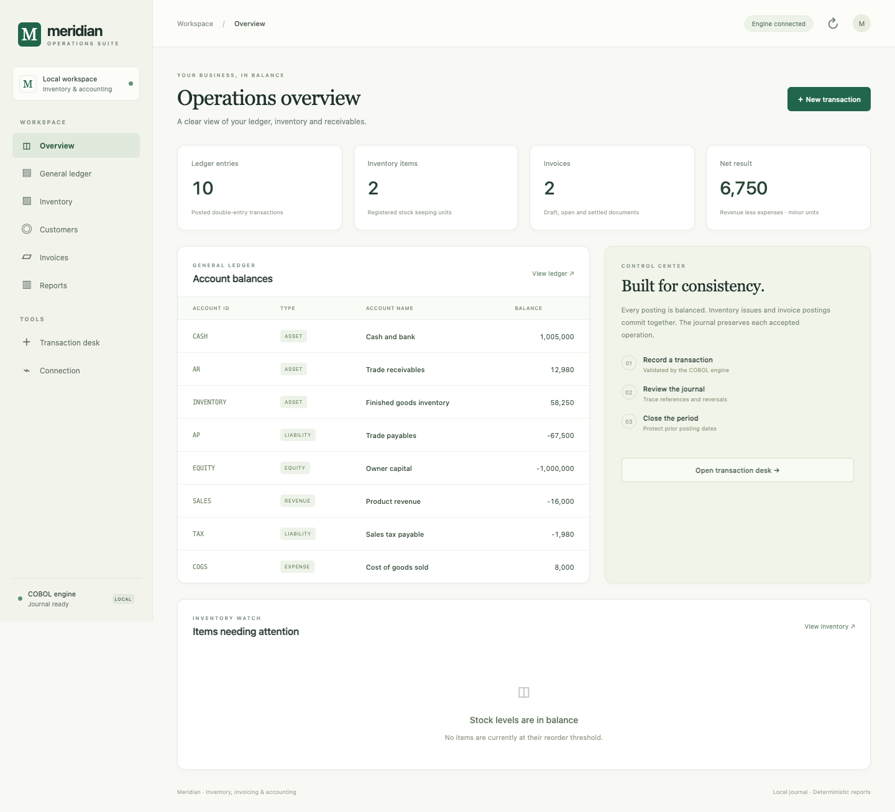
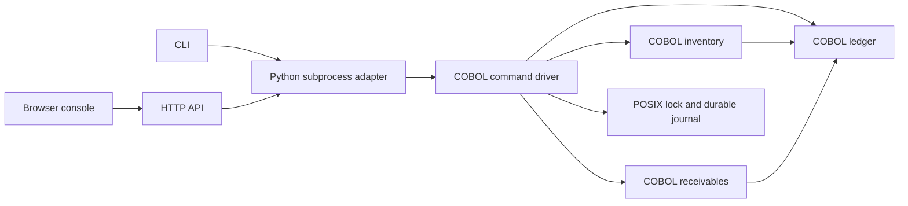

# Meridian COBOL

[](https://github.com/DhruvMishra1826/meridian-cobol/actions/workflows/ci.yml)

An order-to-cash operations application with a **COBOL business engine**, durable journal, command-line tools, authenticated HTTP API, and browser console.

Meridian brings together double-entry bookkeeping, fixed-cost inventory, customer invoicing, integer-cent tax calculation, partial payments, receivables aging, and recoverable audit history. The same compiled engine serves every interface; the Python adapters do not reimplement business rules.



## Start in five minutes

Prerequisites: GnuCOBOL 3.1 or newer, a C11 compiler, Make, and Python 3.9 or newer. Linux and macOS are supported; POSIX file locks are required. For deployments, use a currently supported Python release such as the container's Python 3.11.

```bash
# Ubuntu / Debian
sudo apt-get update
sudo apt-get install gnucobol gcc make python3

# macOS alternative
brew install gnucobol

git clone https://github.com/DhruvMishra1826/meridian-cobol.git
cd meridian-cobol
make
make test
python3 tools/demo.py --data-dir demo-data
python3 tools/server.py --data-dir demo-data
```

Open **http://127.0.0.1:8080**. The console includes guided forms, filtered report tables, invoice inspection, CSV exports, and financial metrics. The seeded company and transactions are synthetic fixtures; `demo.py` refuses an existing nonempty journal.

For a clean business dataset, select a fresh directory:

```bash
python3 tools/meridian.py --data-dir data command 'ACCOUNT|CASH|ASSET|Cash'
python3 tools/meridian.py --data-dir data command 'ACCOUNT|EQUITY|EQUITY|Owner capital'
python3 tools/meridian.py --data-dir data command \
  'POST|CAPITAL_001|20261013|CASH|EQUITY|1000000|Opening capital'
python3 tools/meridian.py --data-dir data --format json report TRIAL
```

Amounts are **integer minor units**, so `1000000` means 10,000.00 in the company's chosen two-decimal currency. Meridian handles one currency per dataset. Dates use Gregorian `YYYYMMDD`; identifiers are uppercase ASCII letters, digits, underscores or hyphens.

## What works

| Area | Implemented behavior |
| --- | --- |
| Accounting | Typed chart of accounts, balanced postings, preserved-original manual reversals, period closing, statements, trial balance, profit summary |
| Inventory | Fixed standard costs, supplier receipts, signed stock adjustments, depletion on invoicing, reorder report, immutable movement history |
| Receivables | Customers, draft invoices, up to 30 item lines, per-line tax rounding, atomic issue, partial payments, settlement, draft void, current-balance aging |
| Persistence | Single-writer locking, ordered CRC-linked journal records, full business-rule replay, `fsync` acknowledgment, corruption detection |
| Batch | Up to 64 mutations committed as one journal event; complete rollback when any operation fails |
| Operations | Verified SHA-256 backup envelopes, restoration into a fresh directory, deterministic demo, text/JSON/CSV interfaces |
| Web | Same-origin local console, bearer protection for remote use, bounded requests, validated report endpoints, no shell execution |

An invoice issue atomically checks stock, records revenue/tax/cost postings, and depletes inventory. A later failure in the tax or cost posting leaves **all earlier changes unapplied**. Duplicate references, overpayment, closed-period dates, missing accounts, invalid dates, stock shortages, and numeric overflow are rejected before acknowledgment.

## Example workflow

The demo contains two products and two invoices. Follow one invoice through:

```bash
python3 tools/meridian.py --data-dir demo-data report 'INVOICE-SHOW|INV_0001'
python3 tools/meridian.py --data-dir demo-data report STOCK
python3 tools/meridian.py --data-dir demo-data report 'AGING|20261120'
python3 tools/meridian.py --data-dir demo-data report JOURNAL
python3 tools/meridian.py --data-dir demo-data report SUMMARY
```

Create your own atomic import from one command per line:

```bash
python3 tools/meridian.py --data-dir data batch examples/opening.batch
```

The batch parser ignores blank lines and `#` comments. A batch accepts only mutations, has a 4,096-byte total limit, and never commits partial results.

## Build, lint and tests

```bash
make check                         # COBOL/C warnings are errors; Python syntax
make test                          # Real compiled-engine and HTTP integration tests
python3 -m venv .venv
.venv/bin/python -m pip install -r requirements-dev.txt
.venv/bin/python -m ruff check tools tests
.venv/bin/python -m ruff format --check tools tests
make coverage                      # Instrumented COBOL/native C execution reports
# Optional console development checks (Node.js development tooling):
npm ci
npm run lint
```

Tests cover reconciliation across ledger and subledgers, rounding boundaries, overflow, exact collection limits, replay and corrupt histories, concurrent writers, atomic batch rollback, backups/restoration, HTTP authentication, request bounds, and unsafe origins. See [testing](docs/TESTING.md) for measured coverage and its scope. Compiler-generated code coverage is reported separately from application source mappings; test counts alone do not establish coverage.

CI compiles, checks, lints, tests, publishes coverage artifacts, and smoke-tests the container. Actions are pinned to verified commit SHAs. Dependabot tracks development tooling, GitHub Actions, and container bases. Runtime adapters require **no third-party Python packages**.

## Containers and remote access

```bash
docker build -t meridian-cobol:local .
# Set a strong token locally; never commit it.
export MERIDIAN_API_TOKEN="$(python3 -c 'import secrets; print(secrets.token_urlsafe(32))')"
docker compose up --build
```

Use `.env.example` as an environment-variable reference. Keep real secrets outside the repository. The Python server is intended for local/private operation; expose it through a TLS reverse proxy on a trusted network. Remote binding requires a bearer token. It has no multi-user roles, public-account registration, or internet-facing hardening claim.

## Backup and restore

```bash
python3 tools/backup.py create --data-dir data --output backups/company.json
python3 tools/backup.py restore --input backups/company.json --data-dir recovered-data
python3 tools/meridian.py --data-dir recovered-data report TRIAL
```

Backup files contain the complete dataset and require the same confidentiality as the live journal. Restoration validates both the envelope and every journal event. Existing datasets are never overwritten. See the [operations runbook](docs/OPERATIONS.md).

## Architecture



Business state is rebuilt from a validated event stream. Each command runs under one exclusive journal lock. Modules operate on shared, bounded COBOL structures; the driver snapshots the complete state and acknowledges a mutation only after its journal record is durably written. This favors deterministic recovery and simple auditability over unbounded scale. See [architecture and decisions](docs/ARCHITECTURE.md), [command contracts](docs/INTERFACE.md), and [HTTP API](docs/API.md).

## Capacity and scope

One dataset supports 200 accounts, 500 items, 500 customers, 500 invoices, 30 lines per invoice, 4,096 ledger entries, 4,096 stock movements, and 2,048 payments. Commands are capped at 4,096 bytes and outputs at 1 MiB. Collection and arithmetic limits are enforced and tested; this is not an unlimited-storage service.

Stock uses fixed standard cost and whole units; no FIFO/weighted-average valuation, foreign exchange, bank integrations, payroll, jurisdiction-specific tax filing, or automatic credit notes. Issued invoices and payments are immutable. Manual reversals cannot undo integrated stock/invoice/payment entries; compensating inventory adjustments are supported. Aging reports use current outstanding balances and are operational snapshots, not historical payment reconstructions. Manual postings to control accounts should follow the reconciliation runbook.

The demo uses synthetic data. Review the documented limits and recovery procedure before using live business records.

## Further documentation

* [Inventory](docs/INVENTORY.md) and [invoicing](docs/SALES.md)
* [Architecture](docs/ARCHITECTURE.md), [security](SECURITY.md), and [operations](docs/OPERATIONS.md)
* [HTTP API](docs/API.md), [testing](docs/TESTING.md), and [contributing](CONTRIBUTING.md)
* [Changelog](CHANGELOG.md) and [license](LICENSE)

Copyright 2026 Dhruv Mishra. All rights reserved; contact the repository owner for licensing.
